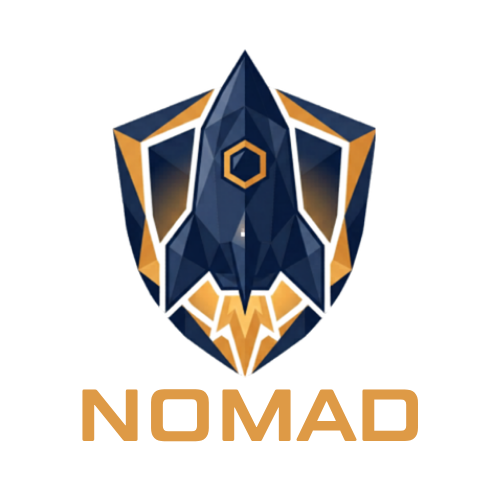

<h1 align="center">
  
</h1>

  
  
  
  
  

Nomad Launcher downloads, verifies, configures, and starts a browser from a
portable folder on **Windows 10/11 (64-bit)**. The browser, profile, and launcher
settings stay beside the `.exe`. Normal use needs no administrator rights.

## Get started

1. Download your launcher from the [latest release](https://github.com/cyph3rpuNk-dev/Nomad-Launcher/releases/latest) and [verify it](docs/VERIFYING-RELEASES.md).
2. Put it in its own dedicated empty folder.
3. Run it directly. The first run needs internet access to download the browser.

> **One browser per folder.** Different Nomad launchers must never share the same
> `Browser/`, `Data/`, and `Nomad/` directories. Close the browser before moving
> the complete portable folder.

Run the launcher directly for updates. Opening a link through a registered
Nomad browser uses the existing installation and does not install or update
software. See [default browser setup](docs/USER-GUIDE.md#default-browser-registration).

## Supported browsers

| Launcher | Browser | Package verification |
|---|---|---|
| `Nomad-Mullvad.exe` | [Mullvad Browser](https://mullvad.net/en/browser) | GPG + SHA-256 |
| `Nomad-LibreWolf.exe` | [LibreWolf](https://librewolf.net) | SHA-256 |
| `Nomad-Floorp.exe` | [Floorp](https://floorp.app) | SHA-256 |
| `Nomad-Waterfox.exe` | [Waterfox](https://www.waterfox.net) | SHA-512 |
| `Nomad-Chromium.exe` | [Ungoogled Chromium](https://github.com/ungoogled-software/ungoogled-chromium) | SHA-256 |
| `Nomad-Helium.exe` | [Helium](https://github.com/imputnet/helium-windows) | SHA-256 |

Floorp also needs the Microsoft Visual C++ Redistributable (x64).
See [requirements and troubleshooting](docs/USER-GUIDE.md#troubleshooting).

## Know before using

- Downloads are verified and staged before replacing the browser. Failed
  verification or staging preserves the existing install; failures after a
  successful replacement are outside the [rollback boundary](docs/UPDATE-SAFETY.md#promotion-and-rollback-boundary).
- Privacy hardening is on by default and can affect site compatibility. It
  disables Safe Browsing in Chromium and managed Gecko profiles; review the
  [privacy trade-offs](docs/PRIVACY.md#trade-offs).
- Chromium profile encryption tied to Windows is disabled for portability,
  even with hardening off. Use an encrypted volume for sensitive profiles.
- Cleanup is best effort: Windows can retain traces. Nomad does not provide
  anonymity or forensic erasure. Read the [security policy](SECURITY.md).

## Documentation

Change settings in `Nomad/nomad.toml`; the user guide explains each option.

| Need | Guide |
|---|---|
| Settings, folder layout, default browser setup, troubleshooting, FAQ | [User guide](docs/USER-GUIDE.md) |
| Hardening choices and cleanup limits | [Privacy and cleanup](docs/PRIVACY.md) |
| Signatures, checksums, and build provenance | [Verify a release](docs/VERIFYING-RELEASES.md) |
| Build commands and validation | [Development](docs/DEVELOPMENT.md) |
| Ownership rules, updates, and recovery | [Update safety](docs/UPDATE-SAFETY.md) |

For help, check the [troubleshooting guide](docs/USER-GUIDE.md#troubleshooting)
or [open an issue](https://github.com/cyph3rpuNk-dev/Nomad-Launcher/issues).
Report vulnerabilities [privately](SECURITY.md#reporting-a-vulnerability).

## Credits and license

Inspired by [chrlauncher](https://github.com/henrypp/chrlauncher), with hardening
based on [arkenfox](https://github.com/arkenfox/user.js) and
[uBlock Origin](https://github.com/gorhill/uBlock).
Nomad is independent of the browser projects; see [trademarks](TRADEMARKS.md).

Source code: [MIT](LICENSE-MIT). Bundled Atkinson Hyperlegible and 7-Zip retain
their own licenses, included with releases; see [dependency notices](docs/VENDORED-DEPENDENCIES.md).
